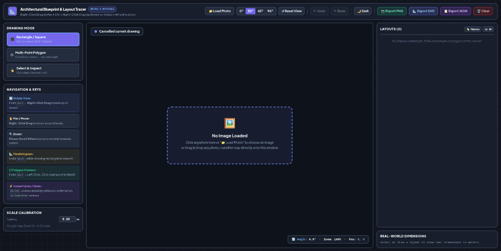

# 📐 GeoTrace — The Zero-Install Blueprint & Satellite Layout Tracer

> **Because you shouldn't need a 10GB CAD install or a design degree just to trace a building footprint on a satellite map.**

[](LICENSE)
[]()
[-success.svg)]()
[]()
[]()
[]()
[](https://deepmind.google/technologies/gemini/)

Ever needed to outline buildings from Google Maps, trace a property boundary, or measure a floor plan, only to realize that every tool out there requires downloading a 10GB software suite, watching 3 hours of CAD tutorials, or paying a monthly subscription?

**GeoTrace was built for beginners, students, indie developers, and anyone who just wants to get things done without the bloat.**

- 🚫 **No huge software installs** (No AutoCAD, Revit, QGIS, or Photoshop needed)
- 🚫 **No complicated CAD tools** or steep learning curves
- 🚫 **No account signups, logins, or subscriptions**
- 🚫 **No cloud uploads** — 100% private and runs offline on your machine

Just open the page in any browser, drop your image, click a few corners, and let GeoTrace automatically calculate real-world meters ($m$), surface areas ($m^2$), and export crisp vector blueprints.

---

## 📸 App Preview



---

## 🚀 Quick Start (Literally Double-Click to Run)

Zero build tools, zero dependencies, zero `npm install`, zero setup. It runs anywhere:

### 1. Download & Open
Download or clone the project and open `index.html`:

```bash
git clone https://github.com/iHaveStaleMemes/geotrace.git
cd geotrace

# Linux:
xdg-open index.html
# macOS:
open index.html
# Windows:
start index.html
```

*(Or simply **double-click `index.html`** in your file manager!)*

---

## 🎯 Why It's Built for Beginners

- **Click 2 Corners $\to$ Done**: To trace a building, just click one corner and click the opposite corner. That's it.
- **Hold Shift to Skew**: If a building is angled, holding <kbd>Shift</kbd> instantly skews the rectangle into a matching parallelogram.
- **Auto-Snap Polygons**: For L-shaped or complex wings, hold <kbd>Ctrl</kbd> and click corner after corner. Clicking the green start dot automatically closes the shape.
- **No Hand Math**: You don't have to calculate scale ratios or areas by hand. It automatically displays wall lengths in meters ($m$) and footprint surface area in square meters ($m^2$).
- **Oops-Proof**: Accidental deletions are blocked (Enter and Backspace won't delete your hard work), and <kbd>Ctrl+Z</kbd> immediately undoes any mistake with zero prompts.

---

## ✨ Features

- 🌙 **Eye-Friendly Dark Mode by Default**: Deep architectural drafting theme (`#080c16`) with high-contrast color outlines. Switch to `☀️ Light` mode anytime with one click.
- 🔄 **Rotate the World, Not Your Head**:
  - Most buildings in real life don't face perfectly North.
  - Hold <kbd>Ctrl</kbd> + **Right-Click Drag** up or down to rotate your view and align angled buildings flat with your screen.
  - Header presets for **0°**, **30°** (standard building alignment), **45°**, and **90°**, plus <kbd>Ctrl</kbd> + **Double Right-Click** to reset.
- 🔍 **Smooth Cursor-Centric Zoom & Pan**:
  - **Mouse Wheel**: Zooms smoothly right into where your mouse is pointing without jumping around.
  - **Right-Click Drag**: Move around your blueprint or satellite map freely.
- 📏 **Real-World Metric Calibration**:
  - Pre-calibrated for Google Maps Zoom 18 ($1\text{ px} = 0.50\text{ m}$).
  - Change the number in the sidebar to match any custom blueprint scale.
- 🎨 **One-Click Recolor & Transparency**:
  - Click any colored circle in the sidebar to open the color picker and change colors on the fly.
  - Pick from 12 quick presets, use custom hex colors, or adjust overlay transparency from 10% to 85%.
- 🏷️ **Clean Footprint Labels (Hidden by Default)**:
  - Add names to your layouts (e.g., `Main House`, `Emergency Wing`, `Garage`).
  - Want to see the names right on top of the drawing? Click **`🏷️ Names`** to show centered, crisp name badges that stay horizontal even when rotating.
  - By default, names stay hidden so your blueprint stays clean and uncluttered.
- ✏️ **Double-Click Renaming**:
  - Click the **`✏️`** icon in the sidebar (or double-click any name) to rename it inline. Press <kbd>Enter</kbd> to save.
- ⚡ **Multi-Layout Bulk Management**:
  - Use checkboxes to select multiple buildings at once.
  - One-click bulk buttons to **Show Names**, **Hide Names**, **Recolor All Selected**, or **Batch Delete**.
- 🛡️ **Accidental Deletion Protection**:
  - Enter and Backspace will never delete a shape.
  - Deleting via the <kbd>Delete</kbd> key or 🗑️ button always asks for confirmation.
- ⚡ **Instant Undo & Redo**:
  - Made a mistake? Press <kbd>Ctrl</kbd> + <kbd>Z</kbd> (or click **↶ Undo**) for instant undo without annoying confirmation dialogs.
  - Redo with <kbd>Ctrl</kbd> + <kbd>Shift</kbd> + <kbd>Z</kbd> or <kbd>Ctrl</kbd> + <kbd>Y</kbd>.
- 💾 **Export in Formats Everyone Can Open**:
  - **📷 PNG**: 1:1 image overlay showing your clean traced borders.
  - **📐 SVG**: Vector format compatible with Inkscape, Illustrator, AutoCAD, or Blender.
  - **📋 JSON**: Metric coordinate data centered at origin ($x, z$) for game engines, simulation models, and web apps.

---

## 🎮 Controls & Shortcuts Cheat Sheet

| Action | Control | What it does |
| :--- | :--- | :--- |
| **Zoom In / Out** | **Mouse Scroll Wheel** | Zooms smoothly towards mouse cursor position |
| **Pan / Move** | **Right-Click Drag** | Pan freely anywhere across the canvas |
| **Rotate View** | **`Ctrl` + Right-Click Drag** | Drag mouse **Up** or **Down** to rotate canvas view |
| **Reset Rotation** | **`Ctrl` + Double Right-Click** | Instantly resets rotation back to 0° |
| **Quick Angle Snaps** | Header buttons (`0°`, `30°`, `45°`, `90°`) | Snaps canvas to common building angles |
| **Draw Rectangle** | Click Corner 1 $\to$ Click Corner 2 | Places a rectangle layout |
| **Skew Parallelogram** | Hold **`Shift`** while drawing | Skews opposite wall to match angled building walls |
| **Draw Polygon** | Hold **`Ctrl` + Left Click** | Adds vertices; click green starting dot to close |
| **Instant Undo** | **`Ctrl` + `Z`** | Reverts last action immediately without confirmation |
| **Instant Redo** | **`Ctrl` + `Shift` + `Z`** or **`Ctrl` + `Y`** | Restores undone action without confirmation |

---

## 📁 Clean, No-Bloat Codebase

Everything is split cleanly into single-purpose files with zero complex build systems:

```text
geotrace/
├── index.html            # UI layout, canvas viewport & modal panels
├── style.css             # Architectural dark/light design system
├── app.js                # Canvas 2D engine, affine transforms & math
├── sample_satellite.png  # Included sample aerial photo for instant testing
├── screenshot.png        # Application preview screenshot
├── README.md             # Documentation
├── LICENSE               # MIT Open Source License
└── .gitignore            # Git configuration
```

---

## 🖼️ Great Sample Photos to Try

If you don't have an image ready, here are 3 great places to start:

### 1. 🏥 Included Sample (`sample_satellite.png`)
- **What it is**: Aerial satellite view of Mohamed Ben Sassi University Hospital in Gabès, Tunisia.
- **Why it's fun**: The buildings are angled at **30°** (click the **30°** button in the header to align them horizontally!).

### 2. 🛰️ Grab Any Building from Google Maps
- Open [Google Maps](https://www.google.com/maps) and switch to **Satellite** view.
- Try searching for famous landmarks:
  - **Apple Park (Cupertino)**: A massive circular ring.
  - **The Pentagon (Virginia)**: Concentric 5-sided polygons.
  - **Any local stadium, university campus, or your own neighborhood**.
- Zoom in until the bottom-right scale shows `20 m` or `50 m` (Zoom 18 = 0.50 m/px).
- Take a screenshot (<kbd>PrtScn</kbd> or <kbd>Shift</kbd> + <kbd>Win</kbd> + <kbd>S</kbd>) and drop it into GeoTrace!

### 3. 📐 Architectural Floor Plans
- Drop any JPG or PNG floor plan to quickly measure room footprints and calculate square meters.

---

## 👥 Authors & Acknowledgments

- **shi5memes** ([@iHaveStaleMemes](https://github.com/iHaveStaleMemes)) — Concept, project direction, and UI/UX design
- **Google Gemini** ([Antigravity](https://deepmind.google/technologies/gemini/)) — AI pair programming, Canvas 2D engine & metric algorithms

---

## 📄 License

This project is licensed under the [MIT License](LICENSE) — free for personal, educational, and commercial use.
